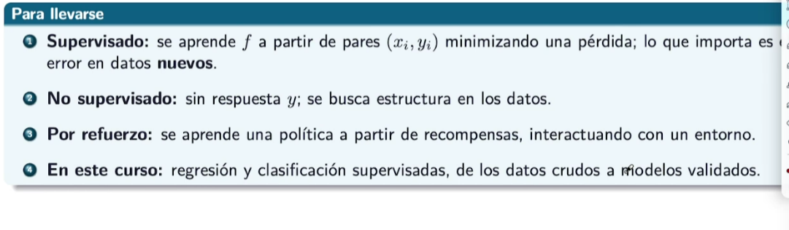

# Aprendizaje Supervisado

Hay 2 tipos

- Regresion: Calcula un valor/ prediccion.
- Clasificacion: Evalua tipo o caracteristica.

Se tiene un conjunto de datos etiquetados con los cuales ya se tiene una respuesta, se busca con el modelo corregir los errores y ajustarlo de manera que estos disminuyan.

Con los datos de entrenamiento, si se puede tener valor 0 ya que se puede sobreentrenar, pero al trabajar con datos nuevos este aumenta, y en este caso, no puede NUNCA llegar a cero.

# Aprendizaje No Supervisado

No supervisado (clasificar igual y reduccion de dimension (PCA))

# Aprendizaje por refuerzo

> IDEAS CLAVE:

EDA

- Datos crudos -> Inspeccionar -> Limpieza y transformacion ->.....

Antes de entrar con cualquier modelo, es importante primero inspeccionar y revisar los datos. Queremos primero buscar por la forma que tienen, su centro, dispersion. Cosas raras, atipicas, topes, o erroes. Y como se relacionan los datos, si son pares y matrices.

Datos - filas.
variables - columnas.

- Sacar media, media, mediana para analizar el comportamiento de datos. Tener cuidado con la media por los outliers.

- Contar atipicos con la regla IQR para detectar datos atipicos, lo cual no significa que sean un error/es. De ser atipico, si es un error de captura la corrigo pero si no es correcto o imposible o no tenga sentido, es mejor eliminarlo. Si es un tope/censura se marca con indicador no tratar como dato libre, y de ser un dato real pero raro, se conserva, log.

## Dos varibles numericas: dispersion y hexbin.