# Aprendizaje Supervisado

Cada decision de preparacion debe aprenderse solo del conjunto de entrenamiento y vivir dentro de un pipeline (var de salida, estadistica, etc).

Hay 2 tipos

- Regresion: Calcula un valor/ prediccion.
- Clasificacion: Evalua tipo o caracteristica.

Se tiene un conjunto de datos etiquetados con los cuales ya se tiene una respuesta, se busca con el modelo corregir los errores y ajustarlo de manera que estos disminuyan.

Con los datos de entrenamiento, si se puede tener valor 0 ya que se puede sobreentrenar, pero al trabajar con datos nuevos este aumenta, y en este caso, no puede NUNCA llegar a cero.

# Aprendizaje No Supervisado

No supervisado (clasificar igual y reduccion de dimension (PCA))

# Aprendizaje por refuerzo

> IDEAS CLAVE:

EDA

- Datos crudos -> Inspeccionar -> Limpieza y transformacion ->.....

Antes de entrar con cualquier modelo, es importante primero inspeccionar y revisar los datos. Queremos primero buscar por la forma que tienen, su centro, dispersion. Cosas raras, atipicas, topes, o erroes. Y como se relacionan los datos, si son pares y matrices.

Datos - filas.
variables - columnas.

- Sacar media, media, mediana para analizar el comportamiento de datos. Tener cuidado con la media por los outliers.

- Contar atipicos con la regla IQR para detectar datos atipicos, lo cual no significa que sean un error/es. De ser atipico, si es un error de captura la corrigo pero si no es correcto o imposible o no tenga sentido, es mejor eliminarlo. Si es un tope/censura se marca con indicador no tratar como dato libre, y de ser un dato real pero raro, se conserva, log.

## Que procesar

El mismo modelo, resultados muy distintos. 
El preprocesar datos y estandarizarlos, genera mucho para que los resultados sean mejor.

## Borrar filas o columnas: lo mas simple y su costo.

> Opciones:

- Borrar filas con algun fantante (dropna())
- Borrar la columna si falta casi toda.
- Usar solo los datos disponibles en cada calculo.

A mayor num de columnas, el % de perdida es mayor, por lo que es razonable cuando son pocos faltantes, siendo menos de un 5%.

## Imputacion simple - sustituir por un valor tipico.

> Opciones:

- Media, mediana, moda, constante.

- KNN conserva la forma de distribucion y su dispersion: los valores inputados son distintos entre si y razonables.

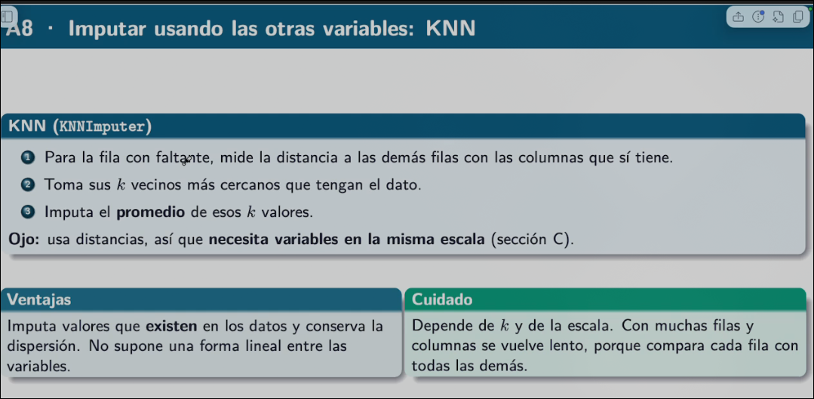

- Imputacion iterativa: Usando temporalmente la media para rellenar, se usa para generar regresiones lineales simples de manera iterativa hasta que el valor obtenido y entrenado sean lo mas similar posible, que estas sean estandarizadas. Esta manera es la de mayor costo y util.

## Variables categoricas - Numeros que les damos.

> Codificaciones:

- Entera y ordinal: 

- One-Hot

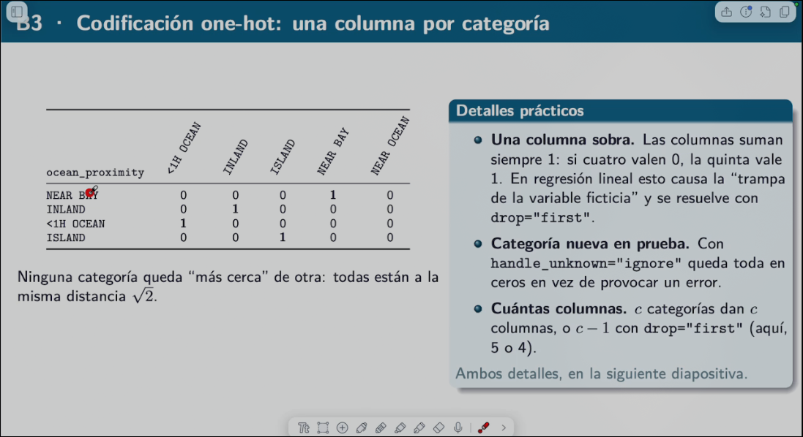

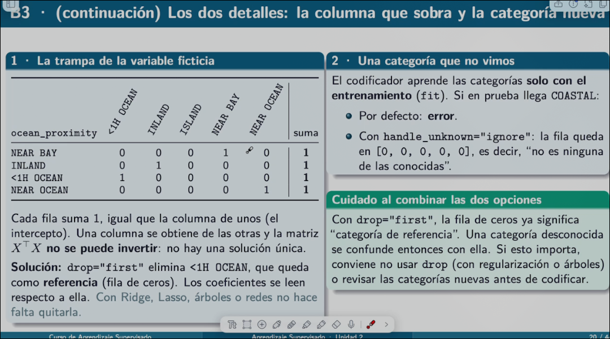

## Escalar variables con unidades muy distantes

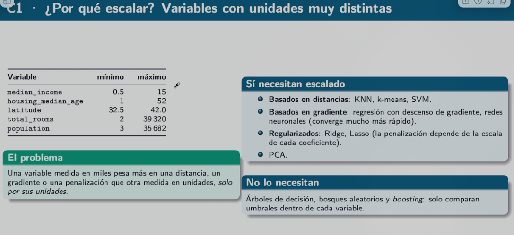
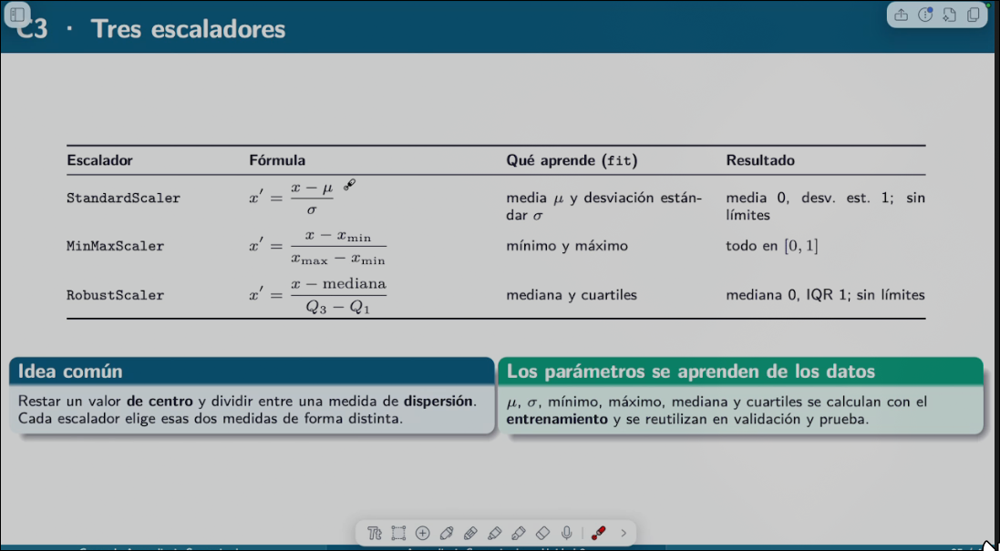

#Ingenieria de variables: codificar el conocimiento del dominio

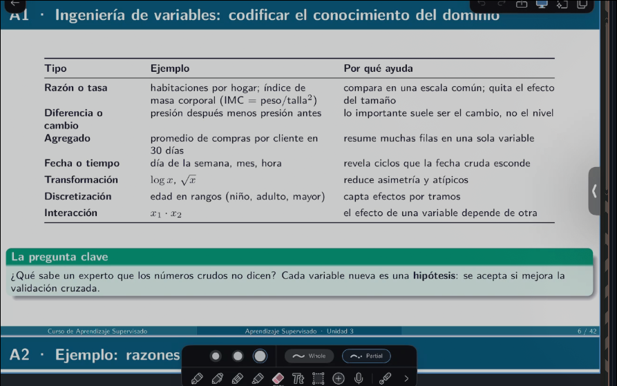

## Variables polinomiales: potencias y productos

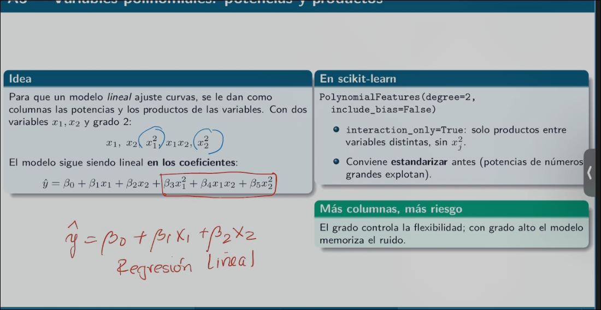

- Interpolacion es cuando la curva de prueba se asemeja o concide con la forma real. Es el ajuste a los grados del polinomio.

- Es mala idea irnos a polinomios bajos y altos por sobre ajuste o poco ajuste respectivamente.

## 3 familias de seleccion de variables

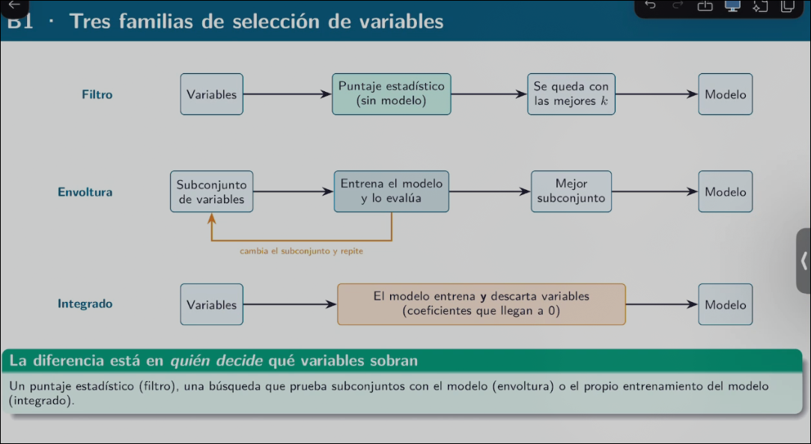

- Usar metodos estadisticos para eliminar variables de inicio, y posteriormente usar otros metodos (RFE  y lasso).

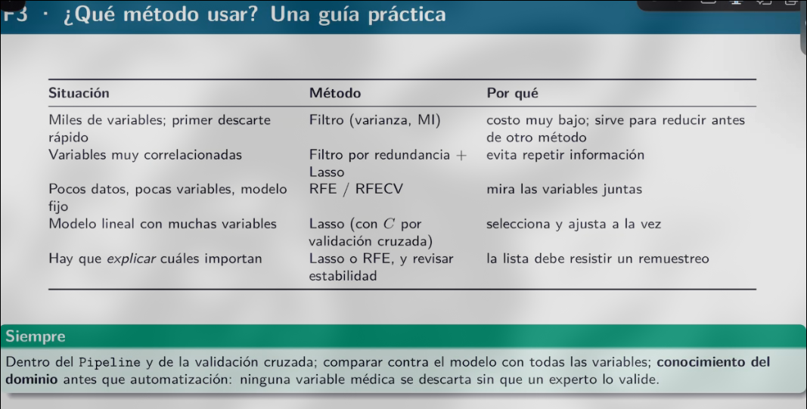
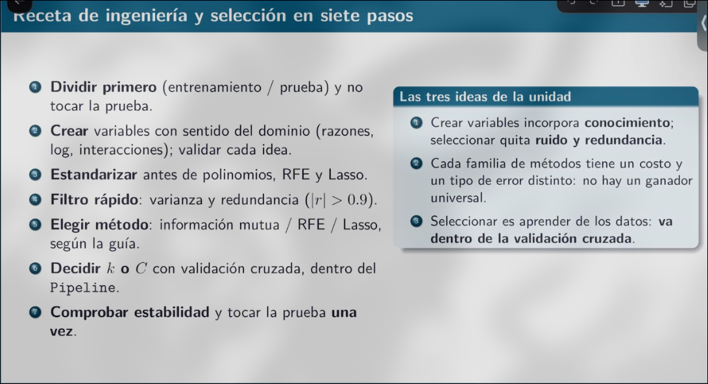

Notas generales:

- Cuando se pueda graficar o visualizar los datos, es mejor hacerlo. Esto claro se vuelve dificil o imposible dependiendo de la cantidad de datos a manejar.

- Conocer var usando las distribuciones y la forma que estas tienen, esto mismo permite identificar los valores atipicos evaluando la asimetria, curtosis excedente, etc.

- Los valores atipicos se tiene que evaluar si es algo que puede suceder y como el modelo se comporta, y ajustar con la seleccion del modelo que se ajuste mas a este tipo de valores, y ya en caso de no requerirse este tipo de valores se evalua el eliminarlos. SIEMPRE se tiene que evaluar apesar que estas se alejen de la media/mediana de los datos.

- Relaciones entre variables:

    - Pearson: Asociacion lineal, sensible a atipicos y escaala. SOLO aplica para lineas, en caso de que no, se evalua el uso de spearman.
    - Spearman: Pearson de los rangos; capta relaciones monotonas e invariante a transformaciones monotonas (log).
    - r = 0 diferente de independencia.
- Usando mapas de calor para evaluar correlacion, s eocnserva el de mayor relacion (r) con respecto al valor de salida.

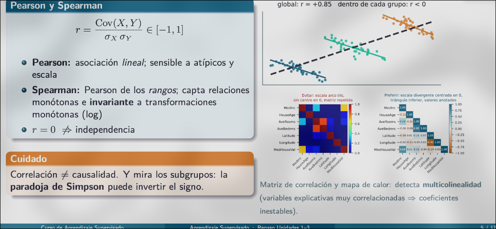 

- Valores faltantes:
    - MCAR: Al azar, no depende de nada. NO estan. Se puede rellenar.
    - MAR: Depende de otras variables observadas.
    - MNAR: Depende del propio valor faltanta.

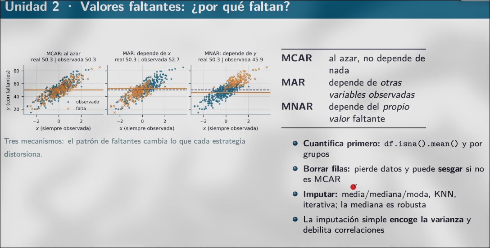

- Codificar y escalar

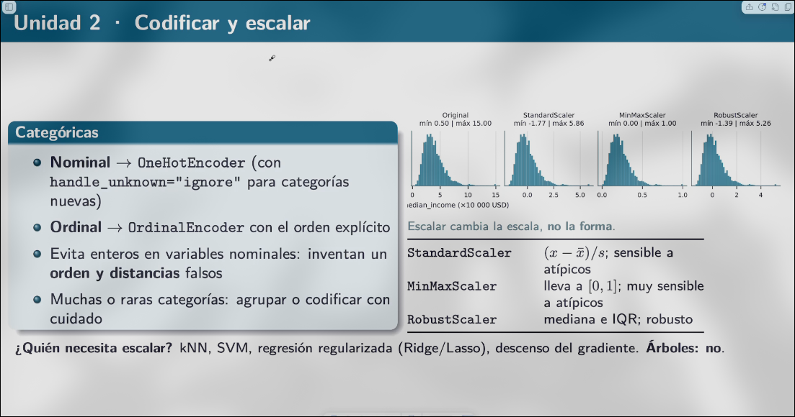

- Dividir bien y evitar la fuga de datos.
    - Entrenamiento, validacion, y prueba.
    - Estratificar si hay clases o categorias raras.

- Crear variables
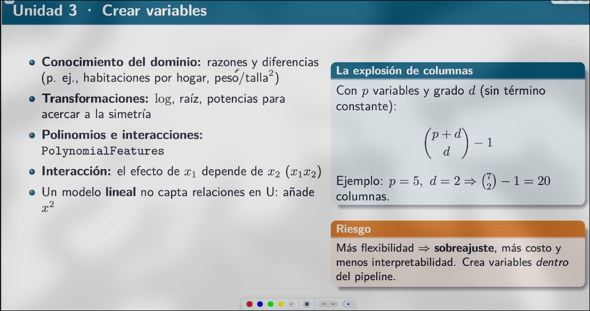

- Familias de seleccion
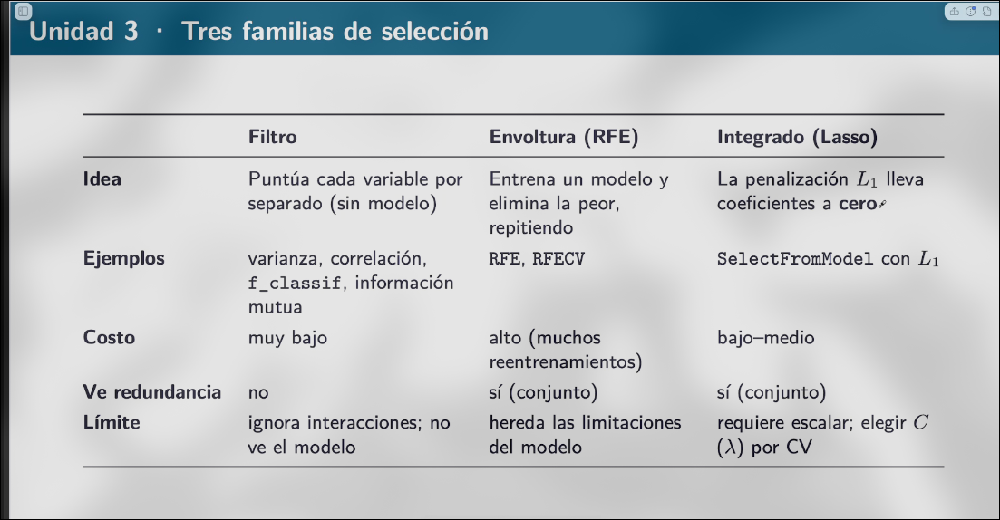

- FIltros.