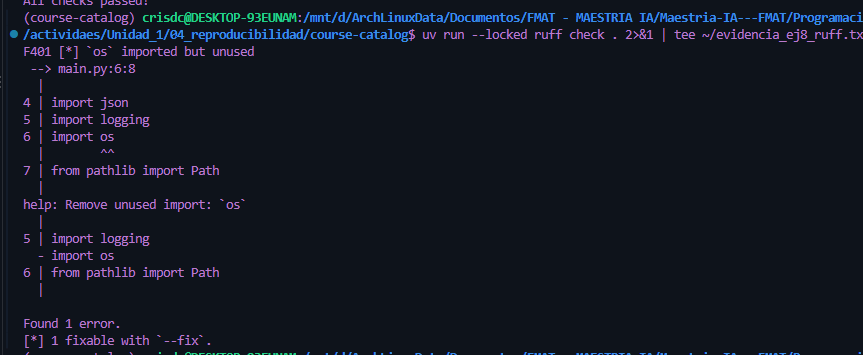

F401 [*] `os` imported but unused
 --> main.py:6:8
  |
4 | import json
5 | import logging
6 | import os
  |        ^^
7 | from pathlib import Path
  |
help: Remove unused import: `os`
  |
5 | import logging
  - import os
6 | from pathlib import Path
  |

Found 1 error.
[*] 1 fixable with `--fix`.

